# AI-Based State-Wise Population Distribution Analysis and Predictive Intelligence System

## Overview

The **AI-Based State-Wise Population Distribution Analysis and Predictive Intelligence System** is a machine learning and data analytics project designed to analyze, visualize, and classify state-wise reported person counts across India.

The project integrates Artificial Intelligence (AI), Deep Learning, Artificial Immune System (AIS), and Particle Swarm Optimization (PSO) to investigate patterns in geographical population-related data.

It uses a neural-network autoencoder to reconstruct observed counts and applies bio-inspired optimization techniques to improve the model's reconstruction performance.

The project also generates statistical summaries, clustering results, correlation heatmaps, comparison graphs, and CSV reports.

> **Important:** The dataset contains state-wise person counts without a time dimension or independent explanatory variables. Therefore, this implementation performs distribution analysis, clustering, and reconstruction rather than reliable future population forecasting.

---

## Project Objectives

The major objectives of this project are:

1. Analyze state-wise reported person counts across India.
2. Identify geographical variations in the dataset.
3. Perform data cleaning and preprocessing.
4. Develop a neural-network autoencoder for data reconstruction.
5. Categorize states into Low, Medium, and High count groups.
6. Apply Artificial Immune System (AIS) optimization.
7. Apply Particle Swarm Optimization (PSO).
8. Evaluate reconstruction performance using statistical metrics.
9. Compare the baseline AI, AIS, and PSO approaches.
10. Generate visualizations and structured output files.
11. Save trained models for reuse and further experimentation.

---

## Technologies Used

| Technology | Purpose |
|------------|---------|
| Python | Core programming language |
| Pandas | Dataset manipulation |
| NumPy | Numerical operations |
| TensorFlow | Deep learning |
| Keras | Autoencoder implementation |
| Scikit-learn | Preprocessing, clustering, evaluation |
| Matplotlib | Data visualization |
| Seaborn | Statistical visualization |
| Joblib | Model component serialization |
| YAML | Configuration management |
| JSON | Metadata and evaluation storage |
| HDF5 | Neural-network model storage |

---

## Dataset Description

### Dataset Name

`RS_Session_259_AU_88_1.csv`

The dataset contains reported person counts for Indian States and Union Territories.

### Dataset Attributes

| Attribute | Description |
|-----------|-------------|
| Sl. No. | Serial number |
| State/UT | State or Union Territory name |
| Persons | Reported number of persons |

### Dataset Characteristics

- Total records: 36
- Total columns: 3
- Geographic coverage: Indian States and Union Territories
- Primary numerical variable: Persons
- Data type: Structured CSV
- India aggregate row: Excluded from model training
- Model input feature: Log-transformed Persons

The exact population category represented by the `Persons` column should be verified against the original dataset source.

### Data Preprocessing

The preprocessing pipeline performs:

1. Loading the CSV dataset.
2. Validating required columns.
3. Converting person counts into numerical values.
4. Removing missing values.
5. Removing duplicate state records.
6. Excluding the India aggregate.
7. Removing invalid negative counts.
8. Applying logarithmic transformation.
9. Standardizing the input feature.
10. Dividing the data into training, validation, and testing sets.

### Log Transformation

To reduce the effect of large numerical differences between states, the project applies:

\[
X_{\log} = \log(1 + X)
\]

where:

- \(X\) represents the original reported person count.
- \(X_{\log}\) represents the transformed value.

The transformed values are standardized using:

\[
Z = \frac{X-\mu}{\sigma}
\]

where:

- \(\mu\) is the training mean.
- \(\sigma\) is the training standard deviation.

---

## System Architecture

The project follows this workflow:

```text
                    INPUT DATASET
                          |
                          v
                   DATA PREPROCESSING
                          |
                          v
                  FEATURE ENGINEERING
                          |
                          v
                   DATA STANDARDIZATION
                          |
                          v
                  NEURAL AUTOENCODER
                          |
             +------------+------------+
             |            |            |
             v            v            v
        BASELINE AI      AIS          PSO
             |            |            |
             v            v            v
        ADAM TRAINING   CLONALG     PARTICLE SWARM
             |            |            |
             +------------+------------+
                          |
                          v
                  MODEL EVALUATION
                          |
                          v
                   K-MEANS CLUSTERING
                          |
                          v
                  RESULT GENERATION
                          |
                          v
              GRAPHS / CSV / MODEL FILES
```

---

## Methodology

The project consists of three major implementations:

1. Baseline Artificial Intelligence Model
2. Artificial Immune System Optimized Model
3. Particle Swarm Optimization Optimized Model

Each implementation performs neural-network reconstruction of observed person counts.

### 1. Baseline AI Model

The baseline implementation uses a deep-learning autoencoder.

An autoencoder learns to reproduce its input through an encoder and decoder network.

#### Neural Network Architecture

```text
Input Layer       : 1 neuron
Encoder Layer 1   : 16 neurons
Encoder Layer 2   : 8 neurons
Latent Layer      : 2 neurons
Decoder Layer 1   : 8 neurons
Decoder Layer 2   : 16 neurons
Output Layer      : 1 neuron
```

#### Activation Functions

Hidden layers use the ReLU activation function:

\[
ReLU(x)=\max(0,x)
\]

The output layer uses linear activation.

#### Loss Function

The neural network minimizes Mean Squared Error:

\[
MSE=\frac{1}{n}\sum_{i=1}^{n}(y_i-\hat{y}_i)^2
\]

where:

- \(y_i\) is the original input value.
- \(\hat{y}_i\) is the reconstructed value.
- \(n\) is the number of observations.

#### Optimizer

The baseline model uses the Adam optimization algorithm.

Adam updates neural-network parameters using adaptive estimates of gradient moments.

#### Model Output

The baseline model produces:

- Reconstructed state-wise counts
- Reconstruction error
- Training and validation loss
- Clustering categories
- Evaluation metrics
- Visualization graphs

---

## Baseline Model Visualization

### Training and Validation Reconstruction Performance

The following graph shows the baseline autoencoder's reconstruction performance.

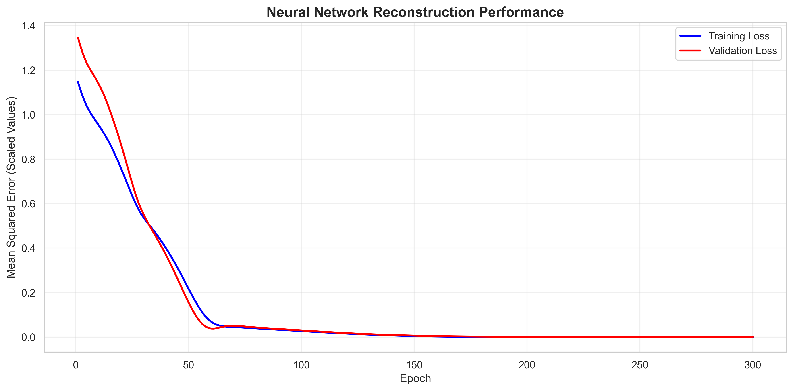

The graph visualizes training and validation reconstruction loss.

A decrease in reconstruction loss indicates that the model is learning to reproduce the observed input values more closely.

This graph represents reconstruction performance, not future population prediction accuracy.

---

## Artificial Immune System (AIS)

### Introduction

Artificial Immune System is a computational intelligence technique inspired by the biological immune system.

AIS algorithms simulate immune processes such as:

- Antibody generation
- Affinity evaluation
- Clonal selection
- Mutation
- Selection
- Population replacement

This project uses the **Clonal Selection Algorithm (CLONALG)**.

### AIS Optimization Objective

The objective is to minimize the neural-network reconstruction error by optimizing its weights.

Each antibody represents a complete set of neural-network weights.

### AIS Working Procedure

1. Train an initial neural-network autoencoder.
2. Convert model weights into an antibody vector.
3. Initialize an antibody population.
4. Evaluate antibody fitness using reconstruction MSE.
5. Select the best antibodies.
6. Clone selected antibodies.
7. Apply mutations to generate candidate solutions.
8. Evaluate the new candidates.
9. Retain the best-performing antibodies.
10. Repeat the process for multiple generations.
11. Select the final model using validation performance.
12. Evaluate the selected model on held-out test data.

### AIS Fitness Function

\[
Fitness(A)=\frac{1}{n}
\sum_{i=1}^{n}(x_i-\hat{x}_i(A))^2
\]

where:

- \(A\) is an antibody representing model weights.
- \(x_i\) is the input value.
- \(\hat{x}_i(A)\) is the reconstructed value.

Lower fitness values represent better reconstruction.

### AIS Configuration

| Parameter | Value |
|-----------|-------|
| Algorithm | CLONALG |
| Population Size | 20 |
| Generations | 60 |
| Clone Factor | 4 |
| Mutation Rate | 0.15 |
| Selected Antibodies | 5 |
| Random Replacements | 3 |
| Random Seed | 42 |

### AIS Convergence Visualization

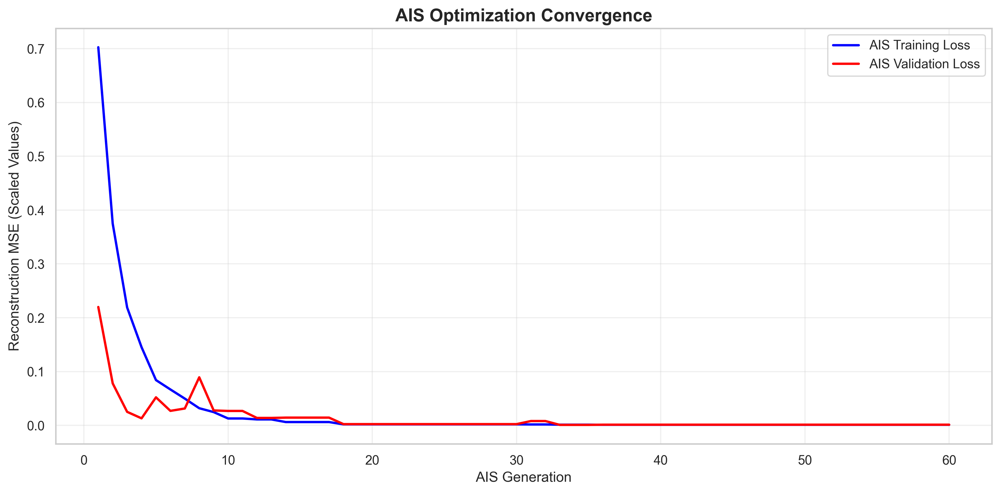

The graph shows the reconstruction loss over AIS generations.

### AIS Results

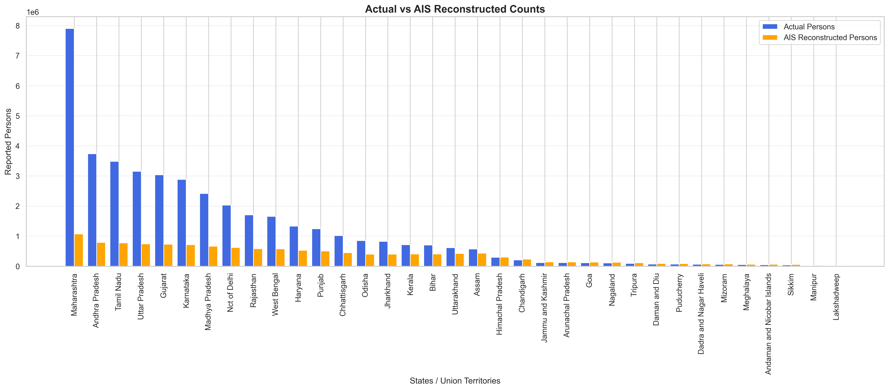

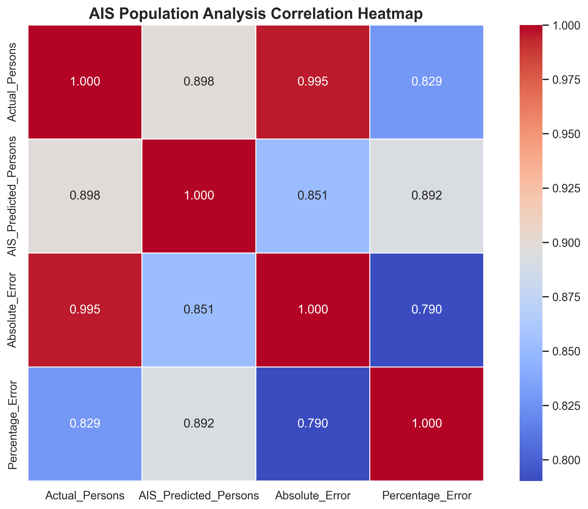

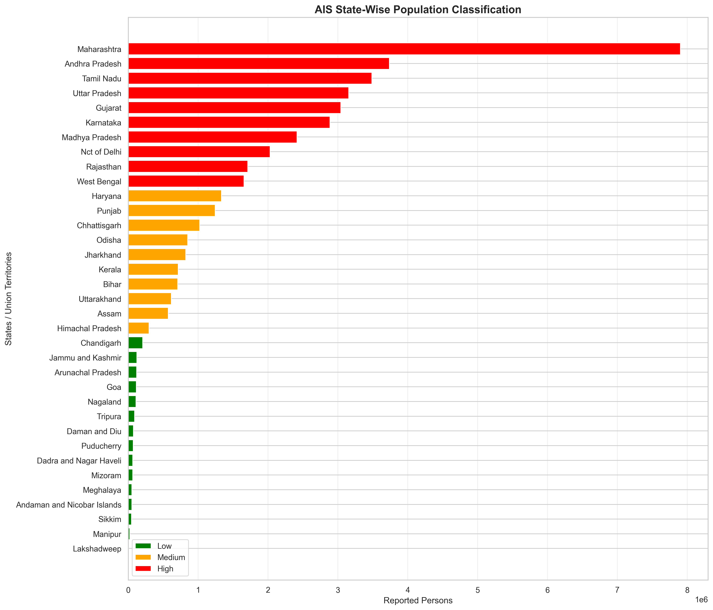

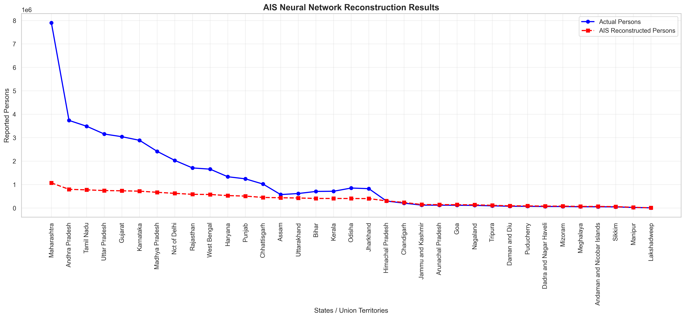

---

## Particle Swarm Optimization (PSO)

### Introduction

Particle Swarm Optimization is a population-based optimization technique inspired by the collective movement of birds and fish.

PSO searches for an optimal solution by updating particle positions and velocities.

Each particle represents a complete neural-network weight configuration.

### PSO Working Procedure

1. Train the initial autoencoder.
2. Convert neural-network weights into particle vectors.
3. Initialize the swarm.
4. Evaluate the fitness of each particle.
5. Record each particle's personal best position.
6. Identify the global best position.
7. Update particle velocities.
8. Update particle positions.
9. Evaluate the updated solutions.
10. Repeat for the configured iterations.
11. Select the final model using validation performance.
12. Evaluate the selected model on test data.

### Velocity Update Equation

\[
v_i^{t+1}
=
wv_i^t
+
c_1r_1(pbest_i-x_i^t)
+
c_2r_2(gbest-x_i^t)
\]

where:

- \(v_i\) is particle velocity.
- \(w\) is inertia weight.
- \(c_1\) is the cognitive coefficient.
- \(c_2\) is the social coefficient.
- \(r_1,r_2\) are random values.
- \(pbest_i\) is the personal best position.
- \(gbest\) is the global best position.

### Position Update Equation

\[
x_i^{t+1}=x_i^t+v_i^{t+1}
\]

### PSO Configuration

| Parameter | Value |
|-----------|-------|
| Algorithm | Particle Swarm Optimization |
| Swarm Size | 25 |
| Maximum Iterations | 80 |
| Inertia Weight | 0.7 |
| Cognitive Coefficient | 1.5 |
| Social Coefficient | 1.5 |
| Position Noise | 0.10 |
| Velocity Limit | 0.15 |
| Random Seed | 42 |

### PSO Convergence Visualization

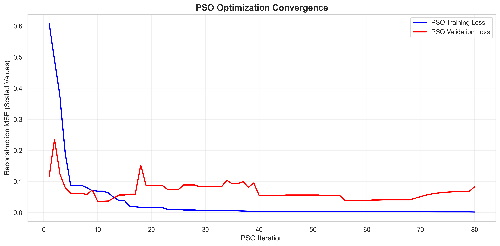

The graph shows how reconstruction loss changes over PSO iterations.

### PSO Results

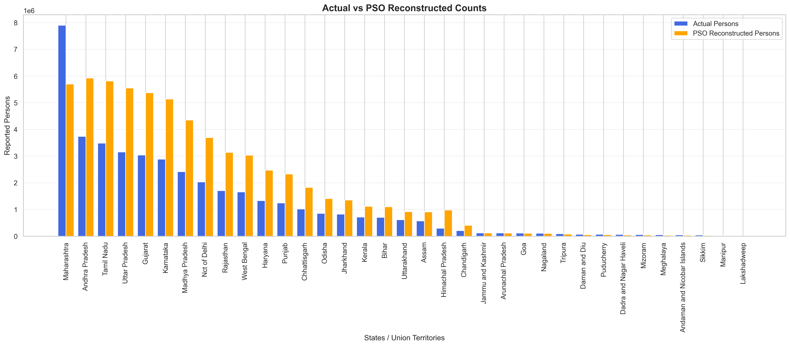

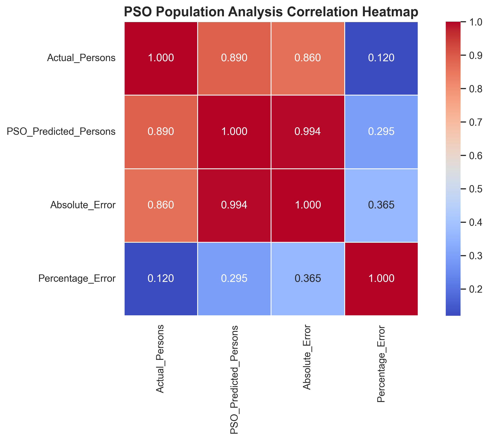


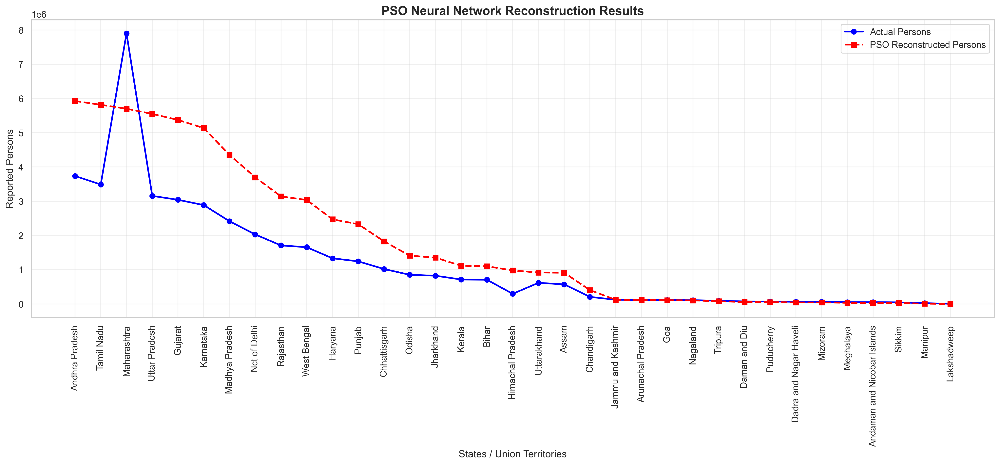

---

## State-Wise Clustering

The project uses K-Means clustering to group states based on reported person counts.

### Number of Clusters

\[
K=3
\]

### Cluster Categories

| Category | Description |
|----------|-------------|
| Low | States with relatively low reported counts |
| Medium | States with moderate reported counts |
| High | States with relatively high reported counts |

Cluster labels are assigned according to the mean reported count within each cluster.

### K-Means Objective Function

\[
J=\sum_{i=1}^{K}
\sum_{x\in C_i}
\|x-\mu_i\|^2
\]

where:

- \(K\) is the number of clusters.
- \(C_i\) represents a cluster.
- \(\mu_i\) is the corresponding cluster centroid.

### Clustering Evaluation

Silhouette Score is used to evaluate cluster separation.

\[
s(i)=\frac{b(i)-a(i)}
{\max(a(i),b(i))}
\]

where:

- \(a(i)\) is the average distance within the same cluster.
- \(b(i)\) is the average distance to the nearest other cluster.

A higher silhouette score generally indicates better-separated clusters.

---

## Evaluation Metrics

The project uses the following metrics to evaluate reconstruction quality.

### Mean Absolute Error (MAE)

\[
MAE=\frac{1}{n}
\sum_{i=1}^{n}|y_i-\hat{y}_i|
\]

MAE measures the average absolute difference between original and reconstructed counts.

### Mean Squared Error (MSE)

\[
MSE=\frac{1}{n}
\sum_{i=1}^{n}(y_i-\hat{y}_i)^2
\]

MSE penalizes larger reconstruction errors more heavily.

### Root Mean Squared Error (RMSE)

\[
RMSE=\sqrt{MSE}
\]

RMSE measures reconstruction error in the original count units.

### Coefficient of Determination (R²)

\[
R^2=
1-
\frac{\sum(y_i-\hat{y}_i)^2}
{\sum(y_i-\bar{y})^2}
\]

R² measures how well reconstructed values correspond to the observed variation.

### Important Evaluation Note

These metrics evaluate the ability of the autoencoder to reconstruct observed data.

They do not measure the accuracy of future population forecasts.

---

## Baseline Results and Visualizations

### 1. Accuracy Graph


Displays the baseline neural network's training and validation reconstruction performance.

### 2. Correlation Heatmap

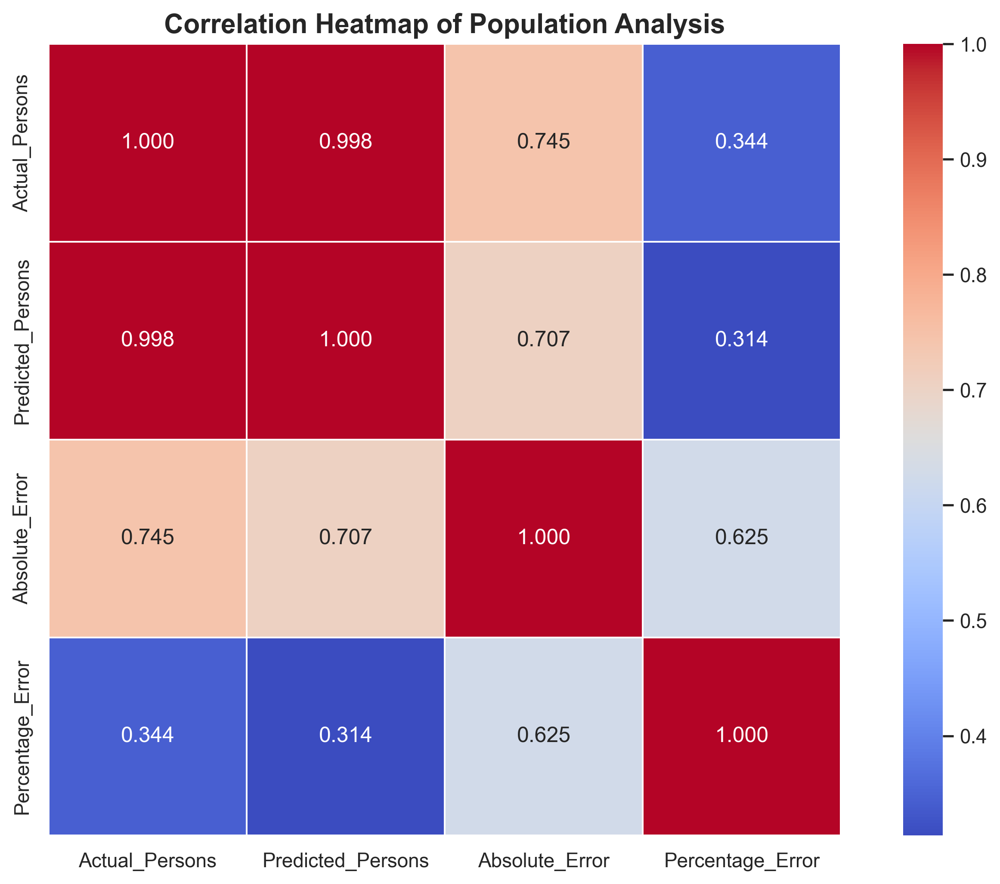

Displays correlations between original counts, reconstructed counts, and reconstruction errors.

### 3. Comparison Graph

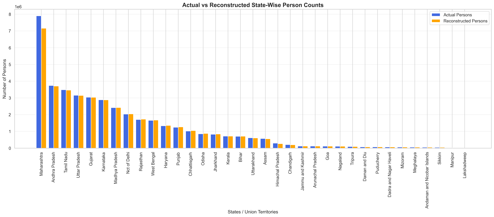

Compares original reported person counts with reconstructed values across states and Union Territories.

### 4. Result Graph

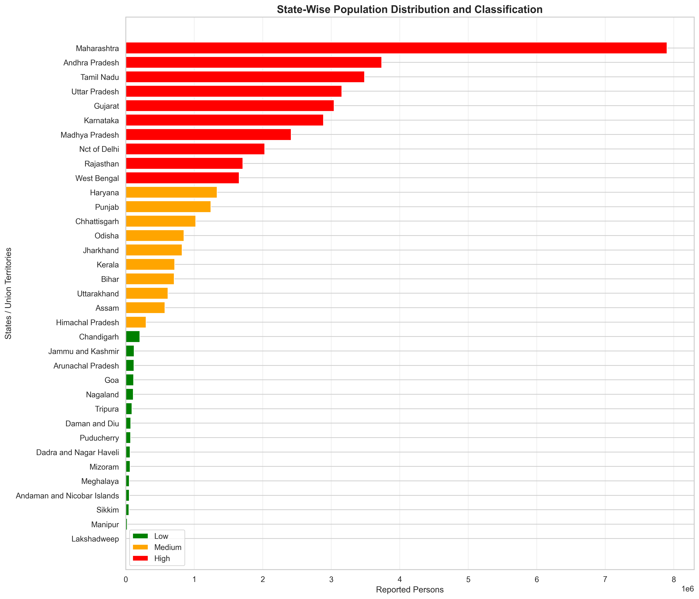

Displays the state-wise count distribution and clustering categories.

### 5. Reconstruction Graph

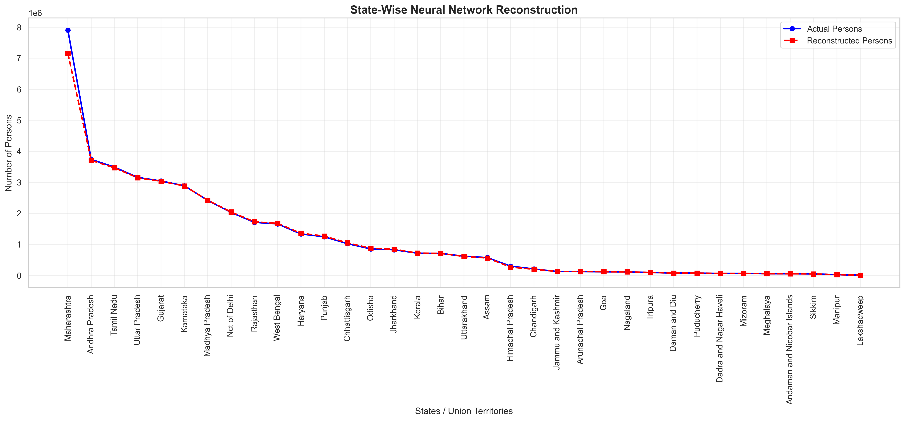

Displays the original and reconstructed counts produced by the baseline model.

---

## Comparison of AI, AIS and PSO

The project provides three model implementations.

| Feature | Baseline AI | AIS | PSO |
|---------|-------------|-----|-----|
| Neural Network | Autoencoder | Autoencoder | Autoencoder |
| Initial Training | Adam | Adam | Adam |
| Additional Optimization | None | CLONALG | Particle Swarm |
| Weight Optimization | Gradient-based | Clonal selection | Swarm intelligence |
| Reconstruction | Yes | Yes | Yes |
| Clustering | K-Means | K-Means | K-Means |
| Graph Generation | Yes | Yes | Yes |
| Model Serialization | Yes | Yes | Yes |
| CSV Export | Yes | Yes | Yes |

### Model Performance Comparison

Performance metrics are saved in:

- `evaluation_metrics.json`
- `ais_evaluation_metrics.json`
- `pso_evaluation_metrics.json`

The evaluation includes:

- MAE
- MSE
- RMSE
- R²
- Silhouette Score

**Note:** The supplied baseline implementation uses a different data split from the AIS and PSO implementations. For a scientifically valid three-model comparison, all three models must be evaluated using identical held-out observations and preprocessing procedures.

---

## Project Folder Structure

```text
AI-Based State-Wise Population Distribution Analysis
and Predictive Intelligence System/
│
├── RS_Session_259_AU_88_1.csv
│
├── README.md
│
├── train_model.py
├── generate_results.py
├── ais_model.py
├── pso_model.py
│
├── population_model.h5
├── population_model.pkl
├── model_config.yaml
├── model_metadata.json
│
├── accuracy_graph.png
├── heatmap.png
├── comparison_graph.png
├── result.csv
├── result_graph.png
├── prediction.csv
├── prediction_graph.png
├── evaluation_metrics.json
├── training_history.csv
│
├── ais_population_model.h5
├── ais_population_model.pkl
├── ais_model_config.yaml
├── ais_model_metadata.json
│
├── ais_accuracy_graph.png
├── ais_heatmap.png
├── ais_comparison_graph.png
├── ais_result.csv
├── ais_result_graph.png
├── ais_prediction.csv
├── ais_prediction_graph.png
├── ais_evaluation_metrics.json
├── ais_optimization_history.csv
│
├── pso_population_model.h5
├── pso_population_model.pkl
├── pso_model_config.yaml
├── pso_model_metadata.json
│
├── pso_accuracy_graph.png
├── pso_heatmap.png
├── pso_comparison_graph.png
├── pso_result.csv
├── pso_result_graph.png
├── pso_prediction.csv
├── pso_prediction_graph.png
├── pso_evaluation_metrics.json
│
└── pso_optimization_history.csv
```

---

## Installation and Setup

### Step 1: Install Python

Install Python 3.10 or 3.11.

Verify installation:

```bash
python --version
```

### Step 2: Open the Project Directory

For Windows CMD:

```bat
cd /d "C:\Users\sagni\Downloads\AI-Based State-Wise Population Distribution Analysis and Predictive Intelligence System"
```

### Step 3: Create a Virtual Environment

```bash
python -m venv venv
```

Activate the environment:

```bat
venv\Scripts\activate
```

### Step 4: Install Dependencies

```bash
pip install numpy pandas matplotlib seaborn scikit-learn tensorflow joblib pyyaml h5py
```

### Step 5: Verify Dataset

Ensure that the following file exists in the project directory:

```text
RS_Session_259_AU_88_1.csv
```

---

## How to Run the Project

### Run Baseline Model Training

```bash
python train_model.py
```

This generates:

- Trained autoencoder model
- Preprocessing components
- Configuration files
- Model metadata
- Training history

### Generate Baseline Results

```bash
python generate_results.py
```

This generates:

- Accuracy graph
- Correlation heatmap
- Comparison graph
- Result CSV
- Result graph
- Reconstruction CSV
- Reconstruction graph
- Evaluation metrics

### Run AIS Optimization

```bash
python ais_model.py
```

This trains and optimizes the neural network using Artificial Immune System techniques.

All AIS outputs are saved using the `ais_` prefix.

### Run PSO Optimization

```bash
python pso_model.py
```

This trains and optimizes the neural network using Particle Swarm Optimization.

All PSO outputs are saved using the `pso_` prefix.

---

## Output File Descriptions

### Model Files

| Extension | Description |
|-----------|-------------|
| `.h5` | Serialized neural-network model |
| `.pkl` | Scaler, clustering model, and optimization components |
| `.yaml` | Training and optimization configuration |
| `.json` | Model metadata and evaluation metrics |

### CSV Files

#### result.csv

Contains:

- State/UT
- Actual person count
- Reconstructed person count
- Absolute error
- Percentage error
- Cluster number
- Population category

#### prediction.csv

Contains:

- State/UT
- Actual person count
- Reconstructed person count
- Population category
- Difference

The word `prediction` is retained in the filename for consistency with the project scripts. These values are reconstructions, not future forecasts.

#### ais_result.csv

Contains the corresponding state-wise results from the AIS implementation.

#### pso_result.csv

Contains the corresponding state-wise results from the PSO implementation.

### Graph Files

All graphs are generated using Matplotlib and Seaborn.

The scripts save graphs in PNG format at 300 DPI.

Graphs are also displayed during execution using:

```python
plt.show()
```

---

## Key Features

### Automated Data Processing

The system automatically loads, validates, cleans, and transforms the dataset.

### Deep Learning

A neural-network autoencoder learns to reconstruct reported person counts.

### AIS Optimization

Clonal Selection optimization searches for improved neural-network weights.

### PSO Optimization

Particle Swarm Optimization searches for improved weight configurations using swarm intelligence.

### State Classification

K-Means clustering categorizes states according to reported person-count distributions.

### Statistical Evaluation

Reconstruction performance is measured using MAE, MSE, RMSE, and R².

### Data Visualization

The system generates:

- Training and validation performance graphs
- AIS convergence graphs
- PSO convergence graphs
- Correlation heatmaps
- State-wise distribution graphs
- Actual vs reconstructed comparison graphs

### Automated Export

Results are exported as CSV, PNG, H5, PKL, YAML, and JSON files.

---

## Applications

The system can support:

1. State-wise statistical data exploration.
2. Geographical distribution analysis.
3. Identification of unusually high or low reported counts.
4. Unsupervised clustering experiments.
5. Comparative evaluation of optimization algorithms.
6. Educational research in artificial intelligence.
7. Demonstrations of bio-inspired optimization.
8. Automated statistical reporting.

The results should not be used as direct evidence for policy decisions without verifying the dataset's definition, quality, source, and limitations.

---

## Advantages

- Automated preprocessing
- Reproducible model training
- Neural-network reconstruction
- AIS-based weight optimization
- PSO-based weight optimization
- State-wise clustering
- Multiple statistical evaluation metrics
- High-resolution visualization
- Structured result export
- Reusable saved models
- Modular Python implementation

---

## Limitations

### Small Dataset

The dataset contains only a small number of state-wise observations.

Deep-learning models can easily overfit such datasets.

### Single Numerical Feature

The model uses only the reported person count.

No independent explanatory variables are available.

### No Historical Data

The dataset does not contain a time-series structure.

Consequently, the system cannot reliably forecast future counts.

### Reconstruction vs Prediction

The autoencoder learns to reconstruct the same type of value provided as input.

Low reconstruction error does not imply that the model can predict unknown future values.

### Optimization Limitations

AIS and PSO may improve reconstruction loss, but neither method guarantees better generalization.

### Evaluation Comparability

The current baseline and optimized scripts do not all use identical evaluation splits.

Their reported metrics should not be interpreted as a controlled comparison until the evaluation procedures are aligned.

### Dataset Interpretation

The exact meaning of the `Persons` column must be verified from the original source.

---

## Future Enhancements

Future improvements may include:

1. Integrating historical state-wise data.
2. Adding demographic and socioeconomic explanatory variables.
3. Implementing genuine time-series forecasting.
4. Using LSTM, GRU, or Transformer-based forecasting models when sufficient sequential data becomes available.
5. Developing a Streamlit dashboard.
6. Adding interactive state-wise visualizations.
7. Integrating geographical maps of India.
8. Implementing cross-validation for small datasets.
9. Conducting repeated optimization experiments with multiple random seeds.
10. Performing statistical significance testing between optimization approaches.
11. Adding additional optimization techniques such as Genetic Algorithms and Differential Evolution.
12. Implementing model monitoring and automated reporting.

---

## Research Significance

This project demonstrates the integration of deep learning with bio-inspired optimization techniques for structured numerical data analysis.

The baseline autoencoder provides a reference reconstruction model.

AIS explores neural-network weight configurations through cloning, mutation, and selection.

PSO explores weight configurations through particle interactions and iterative optimization.

Together, these implementations provide an experimental framework for studying optimization behavior, reconstruction error, and computational intelligence techniques.

The project is particularly useful for educational demonstrations of machine learning, unsupervised learning, and optimization algorithms.

---

## Conclusion

The **AI-Based State-Wise Population Distribution Analysis and Predictive Intelligence System** provides an integrated framework for analyzing state-wise reported person counts using machine learning and computational intelligence.

The system combines:

- Data preprocessing
- Neural-network autoencoders
- Artificial Immune System optimization
- Particle Swarm Optimization
- K-Means clustering
- Statistical evaluation
- Automated visualization
- Model serialization
- CSV result generation

The project demonstrates how AI and optimization algorithms can be applied to geographical numerical datasets.

Its current strength lies in descriptive analysis, clustering, reconstruction, and algorithmic experimentation.

With additional historical observations and relevant explanatory variables, the framework could be extended into a genuine predictive intelligence system.

---

## License

This project is intended for educational, academic, and research purposes.

Reuse and distribution of the dataset should comply with the terms of its original source.

---

## Acknowledgment

This project uses Python and open-source machine learning libraries, including TensorFlow, Keras, Scikit-learn, Pandas, NumPy, Matplotlib, and Seaborn.

The implementation demonstrates the application of Artificial Intelligence, Artificial Immune Systems, and Particle Swarm Optimization to state-wise statistical data analysis.
